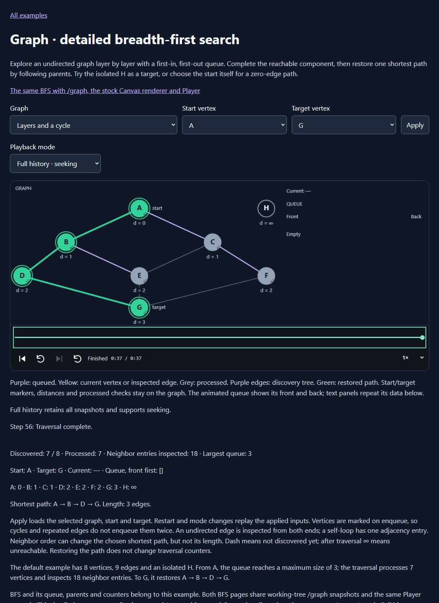
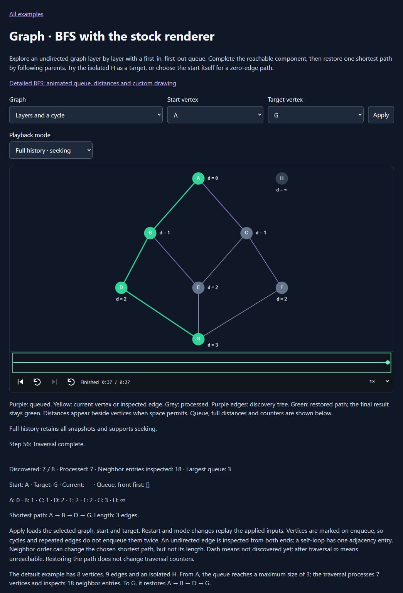

# Two BFS examples: detailed drawing and stock graph renderer

[Русский](ru/bfs-graph-comparison.md) · [Detailed BFS](../examples/graph.html) · [Stock BFS](../examples/graph-player.html) · [Walkthrough](custom-graph-example.md)

**Release follow-up, 2026-11-17:** the graph entries used below are published in
1.1.0. [Release receipt](releases/1.1.0.json). The comparison below records the
earlier example stage; example pages remain repository code.

**2026-11-17; local changes, unpublished.** The detailed example is available again
at graph.html. The stock-renderer version is a separate graph-player.html page.
Both now use the same standard Player. No library implementation, public API,
version or dependencies changed in this example stage. The working-tree graph
entry points are absent from published npm 1.0.0.

## What each page teaches

| | Detailed BFS | Stock renderer BFS |
| --- | --- | --- |
| Purpose | Explain the algorithm and custom visualization | Show composition from ready-made library parts |
| Algorithm/state | Shared graph-algorithm.mjs and createGraphTrace | The same generator and immutable states |
| Drawing | Application-owned /scene objects and Canvas handlers | createGraphRenderer from /canvas/graph |
| Queue | Animated FIFO cells on Canvas plus HTML | HTML panel |
| Distances | Beside each vertex plus HTML | Stock vertex captions when space permits plus HTML |
| Decorations | Start/target rings and labels, processed checks, moving examination dot | Stock graph roles/colors |
| Final answer | Green path derived from application parents/path | Green explicit trace.done result with exact node/edge IDs |
| Controls | Standard Player | The same standard Player |
| Modes | Seekable history and lazy stream with 32-position Previous | The same modes |
| Restart | Applied graph/start/target, with result and rewind reset | The same behavior |

Both traverse the full reachable component before restoring a shortest path.
The default answer is A → B → D → G: 7 processed vertices, 18 inspected neighbor
entries, maximum queue 3. Target=start still completes traversal; H is unreachable;
no target produces no selected path. The example remains undirected/unweighted
and supports loops/parallel edges. Unsupported direction/weights are rejected.

The algorithm, session preparation, controls and HTML panels are shared rather
than copied. graph-page.mjs receives the small drawing wrapper from graph-view.mjs
or graph-player-view.mjs. The custom wrapper supplies immutable state.event to
its scene even when history Frame.event is undefined. Player does not gain graph
or queue drawing responsibilities. Stock drawing now shows distances from nodeCaptions. If space is insufficient,
text is omitted on Canvas but stays in State/HTML.
[Caption acceptance](checks/graph-node-captions-implementation-2026-11-17.json).
Current profiling continues to use the stock
renderer; historical benchmark files keep their original workload scope.

Both pages reuse 650 ms steps, 1000 ms final hold, shared input limits and stock
0.25–16× speeds. Streams request at most 16 new positions per frame. One initial
validation probe is closed before loading a fresh lazy source. History retains a
recording; Restart resets it. Streams retain 32 source positions plus playback/
cache references and create a fresh source on Restart. Mode changes reuse applied
inputs and preserve speed; pagehide disposes resources and bfcache remounts them.

## Verification

- The permanent baseline fixture still checks 179 runs / 6756 semantic steps
  against the pre-migration algorithm. Independent Floyd–Warshall checks cover
  1099 simple graphs and 32110 start/optional-target combinations.
- [Two-view regressions](../test/bfs-two-examples.test.mjs) drive the real drawing
  wrappers with Player history/stream: queue cells, distances, markers, history
  examination dot, green final path, backward replay, Restart and disposal.
- Both pages are checked in the built-in browser. The [current report](checks/bfs-two-examples-2026-11-17.json)
  records exact commands, native observations, screenshots and source hashes.
  This is no new renderer pixel/DPR audit, performance benchmark or CI run.

## Historical first-migration measurement

Before splitting the pages, the first migration compared the original custom
version on commit 3977c78 with a single stock-renderer page:

| Nonblank owned JS lines | Original | First stock version |
| --- | ---: | ---: |
| Algorithm and presets | 106 | 118 |
| Renderer / normalized layout | 165 | 11 |
| Page glue / session preparation | 83 | 101 |
| Total | 354 | 230 |

That 124-line / ~35% reduction belongs to the earlier snapshot in the
[first-migration report](checks/bfs-graph-migration-2026-11-17.json). It excludes
HTML/CSS, library code and the old shared 79-line controller. It is not the code
size of both current examples, a bundle reduction or a performance measurement.
The two pages intentionally retain the detailed renderer. BFS traversal remains
O(V+E); immutable snapshot/annotation work additionally scans nodes/edges per event.
No speed/allocation improvement is claimed.

Detailed drawing with current Player:

The same algorithm with stock drawing and current Player:

