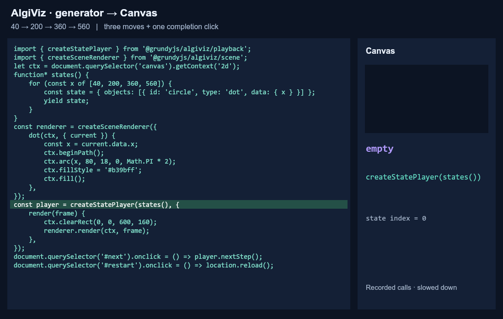

# Getting started

[README](../README.md) · [Русский](ru/getting-started.md)

Start with ready-made controls, switch to manual playback when your application
owns the interface, then introduce `/scene` for custom object types. Algorithms,
state and drawing stay application-owned throughout.

Install `@grundyjs/algiviz` 0.12.0 or later. Load JavaScript as a module through a
bundler that resolves the installed package's public imports. There is no root
entry point. Repository examples use import maps to the local build instead;
see [local setup](minimal-example.md#run-the-repository-example).

## Shared canvas, states and drawing

```html
<div id="player">
  <canvas width="600" height="160"></canvas>
</div>
```

```js
const container = document.querySelector('#player');
const canvas = container.querySelector('canvas');
const ctx = canvas.getContext('2d');

function* states() {
  for (const x of [40, 200, 360, 560]) yield { x };
}

function draw({ current }) {
  ctx.clearRect(0, 0, canvas.width, canvas.height);
  ctx.beginPath();
  ctx.arc(current.x, 80, 18, 0, Math.PI * 2);
  ctx.fillStyle = '#b39bff';
  ctx.fill();
}
```

Every yield creates a fresh snapshot. Do not mutate it after yielding. The drawing
uses only `current`, so positions change without interpolation. The three
integrations below reuse this setup and are alternatives: use one at a time,
and dispose the previous player before replacing an integration.

## 1. Ready-made controls with Player

```js
import { Player } from '@grundyjs/algiviz/player';

const player = new Player(container, {
  viewport: canvas,
  source: states,
  render: draw,
});
```

Construction creates the panel without calling `states`. Start displays the first
state, paused. Each Next state requests the next yield. A request after the last
yield detects exhaustion and preserves the last drawing. There is no lookahead.
Restart invokes the factory again; this is why `source` receives `states`, rather
than an already-created iterator `states()`.

Add `stepDurationMs: 1000` to the options for Play/Pause and speed controls. Timing
alone does not interpolate your drawing: smooth movement requires using
`previous`, `current` and `progress` in the render callback. Call
`player.dispose()` on teardown; controls, timers and listeners are removed while
the canvas and its last drawing remain.

Try the [Canvas recording and SVG stream example](../examples/optional-player.html).
The [player reference](player.md) covers labels, auto-hide, history, errors,
viewport ownership and loading `/player` with dynamic `import()`.

## 2. Your own button with createStatePlayer

Keep the shared setup, add your button after the container, and replace the
`new Player(...)` integration above with the following code:

```html
<button id="next">Next state</button>
```

```js
import { createStatePlayer } from '@grundyjs/algiviz/playback';

const player = createStatePlayer(states(), { render: draw });
document.querySelector('#next').onclick = () => player.nextStep();
```

This version draws the first state immediately during construction. Each click
resumes the generator and renders one next state. One additional click detects
completion. `player.finished` then becomes true. The last frame stays readable.

The application owns its buttons, restart and any animation loop. Restart means
disposing the current instance and constructing another with a fresh `states()`.
On teardown, remove your handlers and call `player.dispose()`.
The `/playback` module itself does not require a DOM; this example's drawing and
button do. See the [playback contract](playback.md).

## 3. Custom object types with /scene

For several object types or stable object identities across states, represent
snapshots as scenes and associate each type with a drawing handler. Keep the
shared canvas, `states()` and manual button; replace the preceding manual
integration with:

```js
import { createStatePlayer } from '@grundyjs/algiviz/playback';
import { createSceneRenderer } from '@grundyjs/algiviz/scene';

function* scenes() {
  for (const data of states()) {
    yield { objects: [{ id: 'circle', type: 'dot', data }] };
  }
}

const renderer = createSceneRenderer({
  dot(ctx, { current }) {
    ctx.beginPath();
    ctx.arc(current.data.x, 80, 18, 0, Math.PI * 2);
    ctx.fillStyle = '#b39bff';
    ctx.fill();
  },
});

const player = createStatePlayer(scenes(), {
  render(frame) {
    ctx.clearRect(0, 0, canvas.width, canvas.height);
    renderer.render(ctx, frame);
  },
});
document.querySelector('#next').onclick = () => player.nextStep();
```

`id` identifies an object across snapshots; `type` selects its handler; `data`
contains your fields. AlgiViz matches objects and dispatches handlers, while the
application chooses geometry, colors and interpolation. The circle exists in
every snapshot here, so its current endpoint is present. Handlers for appearing
or disappearing objects must handle nullable endpoints; see the [scene contract](scene.md).
To combine scenes with ready-made controls, pass `source: scenes` and the same
render callback to `new Player(...)` instead of using the manual integration.



*This GIF shows manual playback with `/scene`, rather than the ready-made panel.
The [interactive walkthrough](../examples/visualization-pipeline.html) slows actual
calls and highlights the path from a click through the generator to drawing
(Russian UI). Its Start button delays player creation so the first frame can be
explained. Follow the [local setup instructions](minimal-example.md#run-the-repository-example).*

## Playback modes and next steps

| | Generator | Finite recording |
| --- | --- | --- |
| Ready-made Player input | `source: states` | `history: () => savedStates`, with `stepDurationMs` |
| Reading and retention | On demand; adjacent snapshots | Array returned on Start; full history |
| Backward seeking | No | Yes |
| Total duration | Unknown | Known |
| Headless API | `createStatePlayer` / `createPlayer` | `createTimeline` |

Generators reduce retained history, not the cost of producing each snapshot.
See [memory and performance](performance.md). `createPlayer` is the explicit-step
alternative when events and a terminal predicate are needed.

Continue with the [standalone scene integration](minimal-example.md),
[complete TypeScript example](../examples/custom-objects.ts),
[graph walkthrough](custom-graph-example.md) or [example catalog](examples.md).
