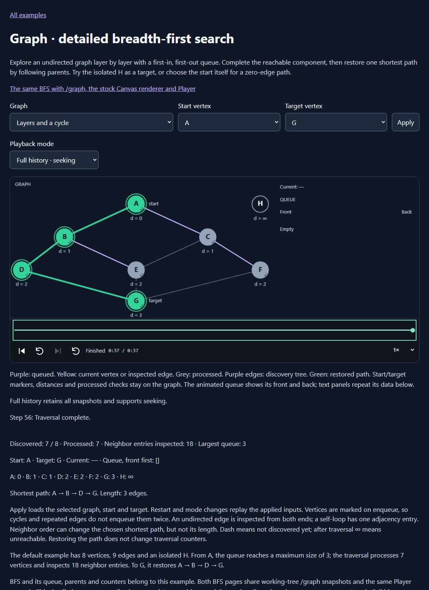
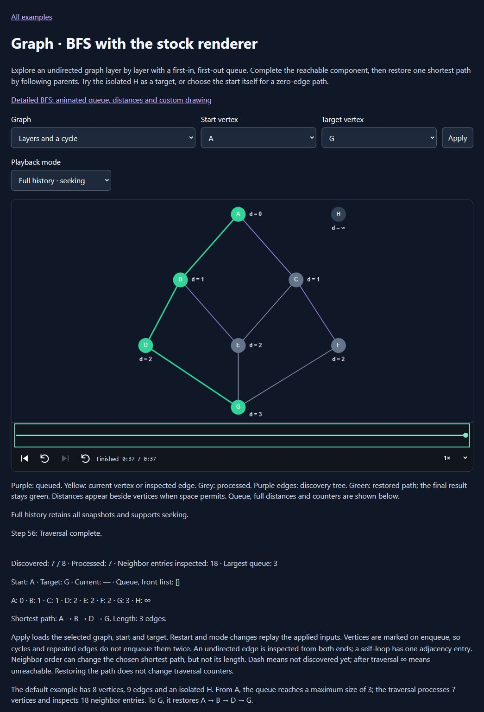

# Два примера BFS: подробное рисование и штатный renderer

[English](../bfs-graph-comparison.md) · [Подробный BFS](../../examples/graph.html) · [Штатный BFS](../../examples/graph-player.html) · [Разбор](../custom-graph-example.md)

**После выпуска, 2026-11-17:** использованные ниже graph entries опубликованы
в 1.1.0. [Отчёт выпуска](../releases/1.1.0.json). Сравнение ниже сохраняет прежний
этап примеров; сами страницы остаются кодом репозитория.

**2026-11-17; локальные изменения, без публикации.** Подробный пример снова
доступен на graph.html. Вариант со штатным renderer выделен в graph-player.html.
Оба используют одинаковый готовый Player. Реализация/API библиотеки, версия и
зависимости на этом этапе не менялись. Graph API рабочей копии отсутствуют в
опубликованной npm 1.0.0.

## Что показывает каждая страница

| | Подробный BFS | BFS со штатным renderer |
| --- | --- | --- |
| Назначение | Объяснение BFS и собственной визуализации | Сборка из готовых частей библиотеки |
| Алгоритм/состояние | Общие graph-algorithm.mjs и createGraphTrace | Тот же генератор и неизменяемые состояния |
| Рисование | Прикладные объекты /scene и Canvas-handlers | createGraphRenderer из /canvas/graph |
| Очередь | Анимированные FIFO-ячейки на Canvas и HTML | HTML-панель |
| Расстояния | У каждой вершины и в HTML | Штатные подписи у вершин при наличии места и HTML |
| Декорации | Кольца/подписи старта и цели, галочки, бегущая точка | Штатные роли/цвета графа |
| Итог | Зелёный путь из прикладных родителей/path | Зелёный явный trace.done result с точными ID |
| Управление | Штатный Player | Тот же штатный Player |
| Режимы | История с seek и ленивый поток с Previous на 32 позиции | Те же режимы |
| Restart | Применённые граф/старт/цель, сброс пути и окна | То же поведение |

Оба примера сначала обходят всю достижимую компоненту, затем восстанавливают
кратчайший путь. Итог по умолчанию — A → B → D → G: обработано 7 вершин, проверено
18 соседей, максимум очереди 3. Старт=цель не отменяет полный обход; H недостижима;
без цели выбранного пути нет. BFS остаётся ненаправленным/невзвешенным, допускает
петли и параллельные рёбра; направление/вес явно отклоняются.

Алгоритм, подготовка сеанса, управление и HTML-панели общие. graph-page.mjs получает
обёртку рисования из graph-view.mjs либо graph-player-view.mjs. Подробная обёртка
передаёт сцене неизменяемый state.event даже в истории, где Frame.event отсутствует.
Player не получает обязанностей рисования графа/очереди. Штатный renderer теперь показывает расстояния из nodeCaptions. При нехватке
места текст скрывается с Canvas, но остаётся в State/HTML.
[Приёмка подписей](../checks/graph-node-captions-implementation-2026-11-17.json).
Текущий profile workload
остаётся на штатном renderer; старые benchmark JSON сохраняют свой объём проверки.

В обеих страницах шаг длится 650 мс, удержание итога — 1000 мс, действуют общие
лимиты входа и штатные скорости 0,25–16×. Поток читает максимум 16 новых позиций за
кадр. Один проверочный начальный шаг закрывается перед свежим ленивым источником.
История хранит запись; Restart сбрасывает её. Поток хранит 32 позиции плюс ссылки
playback/cache, а Restart создаёт новый источник. Смена режима использует применённые
параметры и сохраняет скорость; pagehide освобождает ресурсы, bfcache восстанавливает.

## Проверки

- Постоянная baseline-фикстура по-прежнему сравнивает 179 запусков / 6756
  семантических шагов с прежним алгоритмом. Независимая проверка Floyd–Warshall
  охватывает 1099 простых графов и 32110 сочетаний старта/необязательной цели.
- [Регрессии двух представлений](../../test/bfs-two-examples.test.mjs) проводят
  реальные обёртки рисования через Player history/stream: ячейки очереди,
  расстояния, отметки, точку проверки в истории, зелёный итог, перемотку, Restart
  и dispose.
- Обе страницы проверены во встроенном браузере. [Актуальный отчёт](../checks/bfs-two-examples-2026-11-17.json)
  содержит команды, наблюдения, снимки и хэши. Это не новый pixel/DPR-аудит,
  performance-замер или CI.

## Историческое сравнение первой миграции

До разделения страниц первая миграция сравнивала исходный подробный вариант
коммита 3977c78 с одной страницей со штатным renderer:

| Непустые строки собственного JS | Исходный | Первый штатный |
| --- | ---: | ---: |
| Алгоритм и пресеты | 106 | 118 |
| Renderer / нормализованная раскладка | 165 | 11 |
| Связка страницы / подготовка сеанса | 83 | 101 |
| Всего | 354 | 230 |

Сокращение на 124 строки / ~35% относится к раннему снимку из
[отчёта первой миграции](../checks/bfs-graph-migration-2026-11-17.json). Метрика
исключает HTML/CSS, библиотеку и прежний общий контроллер на 79 строк. Это не
объём обоих нынешних примеров, уменьшение bundle или измерение производительности.
Подробный renderer намеренно сохранён. Сам BFS занимает O(V+E); построение
неизменяемых снимков/отметок дополнительно просматривает вершины/рёбра на событии.
Ускорение или уменьшение аллокаций не заявляется.

Подробное рисование с текущим Player:

Тот же алгоритм со штатным рисованием и текущим Player:

