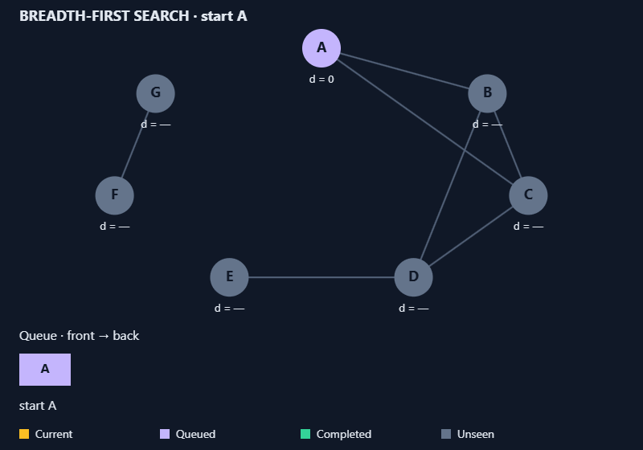

# Каталог примеров

[README](../../ru/README.md) · [English](../examples.md)

## Примеры в браузере



*Алгоритм обхода графа в ширину с собственными объектами, реализованный в приложении.
Экспортировано с [CanvasTake](https://github.com/urffin/canvas-take) —
[попробуйте интерактивную сортировку](https://grundyjs.ru/algorithms/insertion-sort/)
или изучите [исходный код BFS](https://github.com/urffin/algiviz/blob/master/examples/graph-demo.mjs).*

Соберите проект, раздайте корень репозитория статическим HTTP-сервером и откройте
одну из страниц ниже. Примеры — код приложения в репозитории;
в npm-архив они не входят.

| Пример | Что демонстрирует |
| --- | --- |
| [Первый Player](https://github.com/urffin/algiviz/blob/master/examples/getting-started.html) | Однопроходный поиск минимума, штатный Canvas, панель Player и явный итог |
| [Далее: сцены и интерполяция](https://github.com/urffin/algiviz/blob/master/examples/minimal.html) | После quickstart: собственные объекты, явные события, scene IDs и интерполяция |
| [Жизненный цикл объектов](https://github.com/urffin/algiviz/blob/master/examples/object-lifecycle.html) | Пустые сцены, enter/update/exit, чередование advance и nextStep, ранний dispose и журнал чтения генератора |
| [Браузерный плеер](https://github.com/urffin/algiviz/blob/master/examples/optional-player.html) | Импорт `/player` из локальной сборки, запись Canvas с перемоткой и поток SVG только вперёд |
| [Как рождается кадр](https://github.com/urffin/algiviz/blob/master/examples/visualization-pipeline.html) | Путь от генератора через плеер и сцену к отрисовке, показанный средствами AlgiViz |
| [Лаборатория сортировок](https://github.com/urffin/algiviz/blob/master/examples/index.html) | Сортировки вставками и пузырьком с операциями массива и готовым рендерером |
| [Сортировка слиянием](https://github.com/urffin/algiviz/blob/master/examples/merge.html) | Собственное состояние и сцена из двух строк для основного массива и буфера |
| [Разбиения быстрой сортировки](https://github.com/urffin/algiviz/blob/master/examples/quick.html) | Разбиения Ломуто и трёхстороннее с собственными состоянием и сценой |
| [Пирамидальная сортировка](https://github.com/urffin/algiviz/blob/master/examples/heap.html) | Построение max-heap и извлечение с согласованными идентификаторами элементов дерева и массива |
| [Пирамидальная сортировка с Player](https://github.com/urffin/algiviz/blob/master/examples/heap-player.html) | Фиксированный вход `[2a, 2b, 1]` и отдельные панели массива и кучи |
| [Бинарный поиск](https://github.com/urffin/algiviz/blob/master/examples/binary-search.html) | Первое вхождение в отсортированном массиве, замкнутый интервал поиска и ленивое воспроизведение |
| [Подробный BFS графа](https://github.com/urffin/algiviz/blob/master/examples/graph.html) | Своя сцена: анимированная очередь, расстояния у вершин и отметки пути; штатный Player |
| [BFS со штатным графическим renderer](https://github.com/urffin/algiviz/blob/master/examples/graph-player.html) | Тот же алгоритм с createGraphTrace, /canvas/graph и Player |
| [BFS с графом и очередью](https://github.com/urffin/algiviz/blob/master/examples/graph-queue.html) | Тот же BFS с графом и очередью на связном списке в одном Player |
| [Стягивание ребра](https://github.com/urffin/algiviz/blob/master/examples/graph-contraction.html) | Одна операция удаляет вершину и перенаправляет два ребра с сохранением их ID |
| [Минимальное остовное дерево Краскала](https://github.com/urffin/algiviz/blob/master/examples/kruskal.html) | Взвешенный граф и растущий лес с пропуском циклов и зелёным итогом |
| [Кратчайшие пути Дейкстры](https://github.com/urffin/algiviz/blob/master/examples/dijkstra.html) | Граф, расстояния и очередь с приоритетом в одном Player с `stepHistory` |
| [DFS графа](https://github.com/urffin/algiviz/blob/master/examples/dfs.html) | Стек вызовов, возвраты, глубина и путь дерева; история/генератор |
| [Лабиринт](https://github.com/urffin/algiviz/blob/master/examples/maze.html) | Генерация рандомизированным DFS, волна BFS, поиск DFS, циклы и недостижимый выход; история/генератор |
| [BFS на сетке](https://github.com/urffin/algiviz/blob/master/examples/grid-player.html) | Кратчайший путь между препятствиями: /grid, штатный Canvas и Player; расстояния, зелёный итог, история и генератор |
| [Обход дерева](https://github.com/urffin/algiviz/blob/master/examples/tree.html) | Собственные узлы, рёбра и указатель с Canvas и SVG с сохранением элементов |
| [Вставка и поворот дерева](https://github.com/urffin/algiviz/blob/master/examples/tree-player.html) | Вставка 1 в 3 ← 2, один правый поворот, сохранение in-order, зелёный итог, штатный Canvas и Player |
| [Операции со связным списком](https://github.com/urffin/algiviz/blob/master/examples/list-player.html) | Вставка 5 после 7, удаление 3 и разворот цепочки со штатным Canvas и Player (с версии 1.4.0) |
| [Стая Boids](https://github.com/urffin/algiviz/blob/master/examples/boids.html) | Воспроизводимая симуляция, пять окружений и разбор одной птицы с соседями и управляющими векторами |
| [Падающий песок](https://github.com/urffin/algiviz/blob/master/examples/sand.html) | Синхронная клеточная модель, воронка с затвором, редактор препятствий и разбор одной песчинки |

Минимальный разбор `visualization-pipeline.html` использует собственное управление: запуск по кнопке и последовательную подсветку. Общие скорости и режимы к нему не относятся.

Большинство примеров используют общие [demo-player.mjs](https://github.com/urffin/algiviz/blob/master/examples/demo-player.mjs) и
[player-settings.mjs](https://github.com/urffin/algiviz/blob/master/examples/player-settings.mjs): 650 мс на шаг, удержание последнего
кадра 1 000 мс, скорости от 0,25× до 32×, воспроизведение/пауза, перезапуск и переходы
по шагам. История позволяет идти назад и перематывать; режим генератора отключает
обе возможности. При reduced motion интерполяция отключается, скрытые вкладки
приостанавливают воспроизведение.

Все примеры сортировок принимают до **64 конечных значений с историей** или **2 000
в режиме генератора**. Введите значения или создайте массив заданной длины в порядке
Random, Sorted или Reverse. Это ограничения демонстраций, а не библиотеки. Для
переключения большого массива на историю сначала загрузите массив допустимой длины.
Плотные диаграммы скрывают подписи; примеры с собственными сценами сортировок
показывают в текстовом статусе первые 24 ячейки.

## Вставка в бинарное дерево и один поворот

После локальной сборки откройте [examples/tree-player.html](../../examples/tree-player.html).
Фиксированный пример вставляет 1 в левое поддерево 3, затем делает один правый
поворот. Итог: корень 2 с детьми 1 и 3; in-order остаётся 1 → 2 → 3.
Это один случай левого-левого дисбаланса, не полная AVL-вставка.
[Алгоритм](../../examples/tree-player-algorithm.mjs) принадлежит приложению.
Выпущенные в 1.2.0 /tree и /canvas/tree дают неизменяемые шаги, явную раскладку
и штатную отрисовку; нового экспорта алгоритма в библиотеке нет.

Штатный Player использует общие 650 мс на шаг и 1 000 мс удержания итога,
свою панель скорости (0,25×–16×). Генератор хранит восемь шагов, включая текущий;
Previous восстанавливает снимки без повторной вставки и layout. Полная история
также позволяет перематывать сам поворот. Restart создаёт свежий trace; всё
итоговое дерево остаётся зелёным. Пустые слоты показаны пунктирными квадратами.
Прежний [подробный обход](../../examples/tree.html) с собственными узлами,
связями, указателем и Canvas/SVG сохранён отдельным примером.
[Отчёт проверок](../checks/tree-player-example-2026-11-19.json) ·
[Повторяемый native-стенд](../../test/tree-player-browser.html) (раздайте корень репозитория).

## Операции со связным списком

После локальной сборки откройте [list-player.html](../../examples/list-player.html).
[Алгоритм примера](../../examples/list-player-algorithm.mjs) начинает с цепочки
`7 → 3 → 9`, вставляет `5` после `7`, удаляет `3` и разворачивает связи. Каждая
операция записывает полную цепочку одним edit. Между снимками рендерер анимирует
старую и новую цели указателей. Итоговая зелёная цепочка `9 → 5 → 7 → null`
отдельно отмечает значения и слоты указателей.

В обоих режимах работают Previous и Next. Окно генератора хранит до восьми
шагов вместе с текущим. В полной истории можно также перетаскивать ползунок.
Restart заново создаёт исходную цепочку. Пример использует локальные модули
[/list](list-api.md) и [/canvas/list](list-canvas-api.md).

Браузерная проверка запускает пример на ширинах 960 и 390 px в обоих режимах.
Она проверяет кнопки, пиксели результата, размеры Canvas и очистку при уходе
со страницы. [Отчёт проверки](../checks/list-player-example-2026-11-20.json)

## Стая Boids: три правила

Откройте [examples/boids.html](https://github.com/urffin/algiviz/blob/master/examples/boids.html).
Можно независимо включать разделение, выравнивание и сближение, выбирать seed,
число птиц и окружение: без препятствий, круг, три островка, стенка или проход.
Apply фиксирует ввод; перезапуск и смена режима повторяют применённые настройки,
а не черновик формы. Фиксированный LCG обеспечивает воспроизводимость.
Симуляция делает 600 синхронных обновлений и останавливается.

Разбор ставит воспроизведение на паузу и следует за выбранной птицей. Видны
радиус соседства 90 единиц, близкие соседи в радиусе 26, номера соседей, три
взвешенных управляющих вектора, отдельный обход препятствий, сумма и следующая
скорость. Цветные стрелки имеют общий масштаб; белый пунктир показывает только
направление. Расчёт из точного текущего состояния предсказывает следующий такт.
Ограничение скорости и контакт с препятствием указаны отдельно. В разборе нет
интерполяции; обычное воспроизведение сглаживает кратчайшее перемещение через
соединённые края поля. Область восприятия круглая, без угла обзора. Это учебный
вариант модели Рейнольдса, без обещания точного поведения животных или общего
направления всей стаи.

[Модель](https://github.com/urffin/algiviz/blob/master/examples/boids-algorithm.mjs),
[сцена](https://github.com/urffin/algiviz/blob/master/examples/boids-scene.mjs) и
[интеграция](https://github.com/urffin/algiviz/blob/master/examples/boids-demo.mjs) —
код приложения с публичными импортами `/playback` и `/scene`. У птиц стабильные
ID, чистый проектор кеширует неизменяемые состояния, геометрия вычисляется при
рисовании. Общий плеер и кнопки сохранены; пример передаёт интервал 50 мс на такт
и удержание 1000 мс. Остальные примеры сохраняют 650 мс. Необязательный параметр
`timing` и метод `pause()` добавлены только в код общего примера, API пакета не менялся.

История допускает 64 птицы согласно общему лимиту; генератор — до 192, это
дополнительное ограничение этого примера из-за квадратичного поиска соседей.
Такт стоит O(n² + nk), где k — число частей препятствий. Снимок занимает O(n + k),
история O(Tn + k), ленивый плеер держит соседние снимки в O(n + k). Проекция,
отрисовка и разбор выбранной птицы имеют отдельные расходы. Скорость проигрывания
меняет время показа, а не траектории симуляции. Выпуск npm и публикация сайта
для этого примера не требуются.

## Падающий песок

Откройте [examples/sand.html](https://github.com/urffin/algiviz/blob/master/examples/sand.html).
На поле 64 × 54 доступны воронка с затвором, полки, два прохода и пустая коробка.
Кисти шириной 1, 3 и 5 клеток непрерывно рисуют песок и стенки; ластик удаляет
их. Рисование и открытие затвора начинают новую историю на паузе из текущего
положения. Перезапуск и смена режима повторяют зафиксированное поле.

Песчинка предлагает ход вниз, иначе в свободную нижнюю диагональ без пересечения
стенки, иначе остаётся. Все предложения читают предыдущее поле. При конфликте
проходит одна песчинка: seed uint32, такт и стабильный ID обеспечивают повторяемый
выбор. Остальные ждут. Это клеточная модель. Разбор ставит плеер на паузу,
следует за песчинкой и показывает точные соседние клетки 3 × 3, варианты хода
и решение следующего такта, включая конфликт.

Модель, сцена и интерфейс принадлежат примеру и используют общий плеер и публичные
`/playback` и `/scene`. Снимки независимы и неизменяемы, ID сцены следуют за
песчинками. Лимиты примера: 512 песчинок с историей, 2000 в ленивом генераторе,
до 360 тактов. Интервал — 65 мс на такт и 800 мс удержания последнего кадра.
Такт просматривает G клеток и разрешает n предложений за O(G + n); история хранит
O(TG) данных снимков, генератор — соседние снимки за O(G). Проекция, отрисовка
и разбор имеют отдельные расходы. Скорость плеера меняет время показа,
сохраняя те же клеточные обновления.

## Сортировка слиянием

[Алгоритм](https://github.com/urffin/algiviz/blob/master/examples/merge-algorithm.mjs) и [рендерер](https://github.com/urffin/algiviz/blob/master/examples/merge-scene.mjs)
используют `/playback` и `/scene`. Равные значения получают буквенные суффиксы,
чтобы показать устойчивость. Ячейки используют ID строки и позиции, поскольку
копирование из буфера временно дублирует идентичности элементов. При равенстве
выбирается левый элемент. Алгоритм использует O(n) дополнительной памяти;
верхняя граница памяти полной истории снимков — O(n² log n).

## Быстрая сортировка

Выбирайте разбиение Ломуто или трёхстороннее, сохраняя загруженные значения.
Оба алгоритма и их сцена находятся в примере. Трёхсторонняя рекурсия пропускает
область равных: для n ≥ 2 одинаковых элементов нужны 2n скалярных проверок и ноль
обменов, а для этого варианта Ломуто — n(n−1)/2 проверок. Ни один вариант не
гарантирует устойчивость. В худшем случае время квадратичное, рекурсия может
потребовать O(n) памяти стека. Отдельная верхняя граница памяти полной истории — O(n³).

## Пирамидальная сортировка

[Алгоритм](https://github.com/urffin/algiviz/blob/master/examples/heap-algorithm.mjs) определяет неизменяемые состояния и события.
[Сцена](https://github.com/urffin/algiviz/blob/master/examples/heap-scene.mjs) задаёт каждому элементу отдельные визуальные ID в
дереве и массиве и использует публичную проекцию сцен с состояниями, независимыми
от размера экрана. Позиции дерева фиксированы при уменьшении кучи. До 15 ячеек
массива переносятся на узких экранах; более крупные массивы используют плотную строку
без нечитаемых подписей. Построение снизу вверх занимает O(n), сортировка в худшем
случае — O(n log n), итеративный алгоритм на месте использует O(1) дополнительной
памяти. Эта демонстрация копирует вход и хранит O(n) данных соседних снимков в режиме
генератора; полная история может потребовать O(n² log n).
Сортировка неустойчива: [2a, 2b, 1] превращается в [1, 2b, 2a].

## Пирамидальная сортировка с Player

После локальной сборки откройте [heap-player.html](../../examples/heap-player.html).
Он использует тот же генератор сортировки, что и [пример с редактируемым вводом](../../examples/heap.html).
На фиксированном входе `[2a, 2b, 1]` каждый шаг хранит снимок `/array` и снимок
бинарного дерева `/tree` для одного Player.

ID узлов дерева совпадают с ID элементов массива. Обмен переносит `2a`
в последнюю ячейку. На следующем шаге элемент исчезает из дерева, а его
ячейка входит в отсортированный хвост. Панель массива сопоставляет элементы
через `arrayScene` и рисует плитки по раздельным траекториям. В середине
первого обмена обе движущиеся плитки проходят мимо неподвижной `2b` на разной
высоте, поэтому все три подписи читаются. Куча использует штатный
`createTreeRenderer`. В конце куча пуста, а массив имеет порядок `[1, 2b, 2a]`.

Перемотка возвращает обе панели к одному шагу, а Restart восстанавливает
вход. Полная история использует `stepHistory` (1.7.0) и сохраняет событие
алгоритма при перемотке внутрь обмена. Событие массива хранится в общем
снимке и управляет подсветкой плиток.
[Две панели в одном Player](player-multiple-panels.md).
[Нативные проверки Canvas](../../test/heap-player-browser.html) запускаются через тот же HTTP-сервер.

## Бинарный поиск

[Алгоритм](https://github.com/urffin/algiviz/blob/master/examples/binary-search-algorithm.mjs) находит первое вхождение, в том числе
при дубликатах. При равенстве сохраняется кандидат и поиск продолжается слева.
Входной массив должен быть отсортирован; неверный ввод сохраняет текущий сеанс.
Можно генерировать отсортированные массивы заданной длины с общими ограничениями
режимов истории и генератора. Счётчик учитывает проверенные средние элементы.

[Сцена](https://github.com/urffin/algiviz/blob/master/examples/binary-search-scene.mjs) использует стабильные ID по индексам и
проекцию, независимую от размера экрана. До 32 ячеек переносятся; более крупные
массивы отображаются плотной полосой без нечитаемых подписей. Поиск занимает
O(log n) времени и O(1) дополнительной памяти алгоритма. Демонстрация проверяет
и копирует вход за O(n), разделяет замороженный массив между снимками и хранит
O(n + log n) данных истории. Пример не входит в npm-пакет и не требует нового экспорта.

## Обход дерева

Пример определяет собственные типы `node`, `edge` и `pointer`. Указатель проходит
по рёбрам через общих предков между посещаемыми узлами. Выбор Renderer переключает
Canvas и SVG без перезапуска воспроизведения. [tree-svg.mjs](https://github.com/urffin/algiviz/blob/master/examples/tree-svg.mjs)
сохраняет элементы по ID, восстанавливает порядок слоёв и удаляет устаревшие элементы,
даже если перемотка пропустила переход исчезновения. Специальные алгоритм и рендерер
дерева в пакет не добавляются.

## Обход графа в ширину

Три страницы используют один прикладной генератор BFS и одинаковую штатную
панель Player:

- [Подробный BFS](https://github.com/urffin/algiviz/blob/master/examples/graph.html)
  сохраняет прежнее рисование через /scene: анимированную FIFO-очередь, расстояния
  у вершин, отметки старта/цели, галочки обработки и бегущую точку проверки ребра.
- [BFS со штатным renderer](https://github.com/urffin/algiviz/blob/master/examples/graph-player.html)
  показывает createGraphTrace и /canvas/graph; расстояния появляются у вершин при
  наличии места, полные очередь/расстояния остаются в HTML.
- [BFS с графом и очередью](#граф-и-очередь-bfs-в-одном-player) добавляет Canvas
  с FIFO-очередью на /list и /canvas/list под тем же штатным графом.

Выберите граф/старт/необязательную цель и нажмите Apply. Все три примера отмечают вершину
при добавлении в очередь, завершают всю достижимую компоненту и восстанавливают
кратчайший путь по родителям. Итог остаётся зелёным. История поддерживает перемотку;
генератор — Previous в окне последних 32 позиций. Restart и смена режима используют
применённые параметры; скорость сохраняется при Apply и смене режима. Общее время:
650 мс на шаг, 1000 мс удержания итога; штатные скорости 0,25–16×, бюджет потока —
16 запросов за кадр. Допустимы петли/параллельные рёбра; порядок рёбер разрешает
равные пути. Направленные/взвешенные входы этот BFS отклоняет.

GIF выше показывает подробное рисование с прежними кнопками.
[Первое сравнение](bfs-graph-comparison.md) описывает подробный пример,
пример со штатным графом и замеры при переходе на штатный рендерер.
[Разбор](../custom-graph-example.md) описывает общие состояния и управление.

## Граф и очередь BFS в одном Player

После локальной сборки откройте [graph-queue.html](../../examples/graph-queue.html).
Все три страницы используют один алгоритм BFS, те же графы, выбор старта и цели,
сводки расстояний и счётчиков, а также одинаковые настройки воспроизведения.

| Страница | Граф | Очередь |
| --- | --- | --- |
| [Подробный BFS](../../examples/graph.html) | Своя сцена с отметками старта и цели, галочками обработки и движущейся точкой проверки ребра | Своя анимация очереди в той же сцене |
| [BFS со штатным графом](../../examples/graph-player.html) | Штатный Canvas-рендерер, подписи расстояний и зелёный путь | Текст |
| [BFS с графом и очередью](../../examples/graph-queue.html) | Тот же штатный граф | Штатный Canvas списка с узлами и указателем head, плюс та же текстовая сводка |

[Адаптер очереди](../../examples/graph-queue-session.mjs) переводит ID вершин
из очереди BFS в снимок односвязного списка. Добавление и извлечение
записываются одним edit на операцию. На остальных шагах обхода снимок списка
переиспользуется. Оба рендерера получают предыдущий и текущий снимки из одного
кадра и общий прогресс перехода. После обхода рядом с зелёным путём видна пустая
очередь. Полная история перематывает обе панели, а в режиме генератора кнопка
Previous работает в общем окне из 32 шагов. Restart возвращает обе панели к
выбранной стартовой вершине.

Пример отвечает за проекцию очереди и размеры двух Canvas. Готовые рендереры
и Player обеспечивают отрисовку, переходы и воспроизведение.
[Две панели в одном Player](player-multiple-panels.md) объясняет, как панели
используют общий снимок и проецируют один кадр.

## Стягивание ребра

Пример использует динамический API графа из 1.5.0. Соберите проект и откройте
[graph-contraction.html](../../examples/graph-contraction.html) через локальный HTTP-сервер.
Пример стягивает ребро `AB` в вершину `A` одной операцией
[`edit` в `createDynamicGraphTrace`](graph-dynamic-topology.md). Операция
удаляет `B` и `AB`, перенаправляет `BC` с C–B на C–A, а `BD` с B–D
на A–D. ID обоих рёбер сохраняются. Неориентированные рёбра `AC` и
`BC` становятся параллельными. В итоговом кадре `A`, `BC` и `BD`
выделены зелёным.

[Canvas-рендерер](graph-dynamic-canvas.md) с `topologyTransitions` плавно
скрывает удалённые вершину и ребро и показывает переход между старыми
и новыми маршрутами. В обоих режимах Player доступны шаг назад и Restart.
Генератор хранит окно из четырёх шагов, а ползунок полной истории позволяет
посмотреть промежуточный кадр между снимками.

## Минимальное остовное дерево Краскала

Соберите проект, запустите локальный HTTP-сервер и откройте
[kruskal.html](../../examples/kruskal.html). Один Player управляет двумя
Canvas-панелями. `createGraphTrace` сохраняет топологию исходного взвешенного
графа. Отдельный `createDynamicGraphTrace` начинает с пяти вершин и добавляет
принятые рёбра с теми же ID. Рендерер с `topologyTransitions` плавно показывает
их появление в лесу. Алгоритм и проверка компонент находятся в
[коде примера](../../examples/kruskal.mjs).

Рёбра AC, BC, BD и CE соединяют разные компоненты. AB и CD пропускаются,
поскольку замкнули бы цикл. Итоговое дерево имеет суммарный вес 13 и выделено
зелёным на обеих панелях. Previous возвращает обе панели к одному шагу.
Полная история позволяет посмотреть переход между кадрами, а Restart
очищает лес в обоих режимах.

[Нативные проверки Canvas](../../test/kruskal-browser.html) запускаются через тот же HTTP-сервер.
Сборка снимка и проекция кадра описаны в руководстве
[Две панели в одном Player](player-multiple-panels.md).

## Кратчайшие пути Дейкстры

После локальной сборки откройте [dijkstra.html](../../examples/dijkstra.html).
Прямое ребро A → B даёт расстояние 8. При обработке C → B расстояние
снижается до 5, и B обгоняет D в очереди с приоритетом. Перемотка назад
восстанавливает прежнее ребро, расстояние и порядок в очереди одновременно.
На каждом шаге `stepHistory` хранит один снимок для всех трёх панелей.
[Код примера](../../examples/dijkstra.mjs) · [Проверки в браузере](../../test/dijkstra-browser.html).

## Обход графа в глубину

Откройте [examples/dfs.html](https://github.com/urffin/algiviz/blob/master/examples/dfs.html), чтобы сравнить DFS и BFS
на одинаковых графах. Выберите граф, старт и необязательную цель. Каждый явный
кадр вызова хранит курсор следующего соседа; вершина отмечается до входа.
Возврат снимает завершённый вызов и возобновляет родителя. Стек содержит только
активную ветку обхода.

Порядок обнаружения по умолчанию — A, B, D, G, E, C, F; возвратов — F, C, E, G, D, B, A.
Путь дерева DFS до F содержит 6 рёбер; BFS находит A → C → F длиной 2 ребра.
Глубина дерева DFS не является кратчайшим расстоянием. H недостижима.
Путь восстанавливается после полного обхода. Допустимы простые неориентированные
графы; петли и параллельные рёбра отклоняются. Порядок соседей соответствует входу.

На узком экране стек фиксированной вместимости переносится под граф.
Canvas использует логические координаты и DPR. Оба режима используют один
неизменяемый генератор и [общий плеер](https://github.com/urffin/algiviz/blob/master/examples/demo-player.mjs); перезапуск
повторяет применённые входные данные. Генератор вычисляет шаги лениво,
история позволяет перематывать назад. Обход занимает O(V + E) времени и O(V)
дополнительной памяти; верхняя граница памяти истории снимков отдельно составляет
O(V(V + E)). Новые API графа или встроенный DFS в пакет не добавляются.


## Кратчайший путь BFS на сетке

Откройте [examples/grid-player.html](../../examples/grid-player.html) после локальной
сборки и запуска HTTP-сервера из корня репозитория. Это отдельный пример на
/grid, /canvas/grid и Player; grid entry требуют 1.3.0 или новее.
[Прежний лабиринт](../../examples/maze.html) с генерацией по seed, BFS/DFS,
моделью стен между клетками и собственным рисованием сохранён без изменений.
Новый пример использует заблокированные клетки, а не стены между ними.

На сетке 5 × 7 BFS находит кратчайший путь за 10 переходов. Движение разрешено
на север, восток, юг и запад, каждый переход стоит 1. Клетка отмечается при
добавлении в FIFO-очередь; поиск заканчивается, когда цель извлечена. Подписи d=N
сохраняют расстояния от старта. Другой порядок соседей может выбрать иной путь
той же длины. Два дополнительных пресета показывают недостижимую цель и S=T:
нулевой путь — одна зелёная клетка без линии. Координаты — (строка,столбец) от 1.

[Алгоритм](../../examples/grid-player-algorithm.mjs) владеет очередью, родителями
и препятствиями. `createGridTrace` записывает неизменяемые состояния и
`done({ result: { path } })`; `createGridRenderer` рисует значения, расстояния,
линию и зелёный итог.
Вывод очереди и полного пути в HTML доступен независимо от Canvas.

Player использует общие 650 мс на шаг и 1000 мс удержания итога; скорости штатной
панели — 0,25–16×. Генератор хранит окно из 32 позиций, включая текущую; Previous
воспроизводит снимки без повторного поиска. История позволяет перейти в любое
место, включая появление пути. Restart создаёт новую очередь и trace; смена
сетки/режима тоже начинает заново, сохраняя скорость. Pagehide закрывает Player и
viewport; возврат через BFcache создаёт новый сеанс. Проверка параметров/лимита
выполняется до замены сеанса. Общие пределы примеров — 64 клетки для истории,
2000 для генератора; видимые пресеты содержат 35 клеток.

Сам BFS требует O(N) работы и памяти. Копирование O(N) данных на каждом из O(N)
шагов отдельно даёт O(N²) работы и памяти полной истории; фиксированное окно
генератора удерживает O(N) данных. Рисование оплачивается отдельно.
[Релиз 1.3.0](release-1.3.md) ·
[Отчёт проверки](../checks/grid-player-example-2026-11-20.json) ·
[Повторяемая native-проверка](../../test/grid-player-browser.html).
Для повторения native-проверки с сохранением отчёта:

```sh
npm run build
node scripts/test-grid-canvas-browser.mjs --report grid-bfs-native.json
```

Сервер напечатает локальный адрес с выбранным портом. Откройте на нём
`/test/grid-player-browser.html`; для обычного примера — `/examples/grid-player.html`.

## Генерация лабиринта и поиск пути

Откройте [examples/maze.html](https://github.com/urffin/algiviz/blob/master/examples/maze.html). Выберите генерацию по seed, затем BFS или DFS с теми же размерами и seed; Apply загружает выбранную стадию. Координаты — столбец,строка от единицы. Перезапуск и смена режима используют применённые параметры, а не черновые значения формы. Генератор всегда начинает слева сверху и достраивает всю сетку. Поиск завершается, когда выход становится текущей клеткой.

Рандомизированный DFS использует зафиксированный Mulberry32 и одно перемешивание Фишера — Йетса при входе в клетку. Получается связное дерево с N−1 проходами: оба поиска восстанавливают единственный маршрут. В циклическом пресете 3×2 путь BFS содержит один переход, DFS — пять; несвязный пресет показывает отсутствие пути. BFS отмечает при добавлении, обходит соседей в порядке север–восток–юг–запад и считает ожидающие клетки без текущей. DFS использует приостановленные кадры и включает текущую клетку в стек.

Пример использует общий плеер и его ограничения: **64 клетки в истории**, **2000 в генераторе**. Число клеток — произведение ширины и высоты, а не длина стороны. При превышении лимита переход в историю сохраняет текущий сеанс и показывает ошибку. На плотной сетке скрываются нечитаемые подписи; текстовый просмотр фронта ограничен 16 элементами.

Модель стен, неизменяемый генератор, составной объект maze-grid и рисование принадлежат примеру. Используются только публичные /playback и /scene. Подготовка топологии и рабочая память алгоритмов требуют O(N). Каждый снимок анимации копирует O(N) данных: полная история занимает O(N²), ленивый генератор удерживает соседние снимки в O(N), но создание снимка всё равно стоит O(N) на событие. Это отдельная реализация, без упакованного журнала и контрольных точек сайта; его предел 201×201 здесь не применяется.

Исходники: [алгоритм](https://github.com/urffin/algiviz/blob/master/examples/maze-algorithm.mjs), [сцена](https://github.com/urffin/algiviz/blob/master/examples/maze-scene.mjs), [подключение общего плеера](https://github.com/urffin/algiviz/blob/master/examples/maze-demo.mjs). [Разбор на сайте](https://grundyjs.ru/algorithms/maze/) объясняет гарантии, счётчики и код поиска. Новый npm API и релиз не добавляются.
