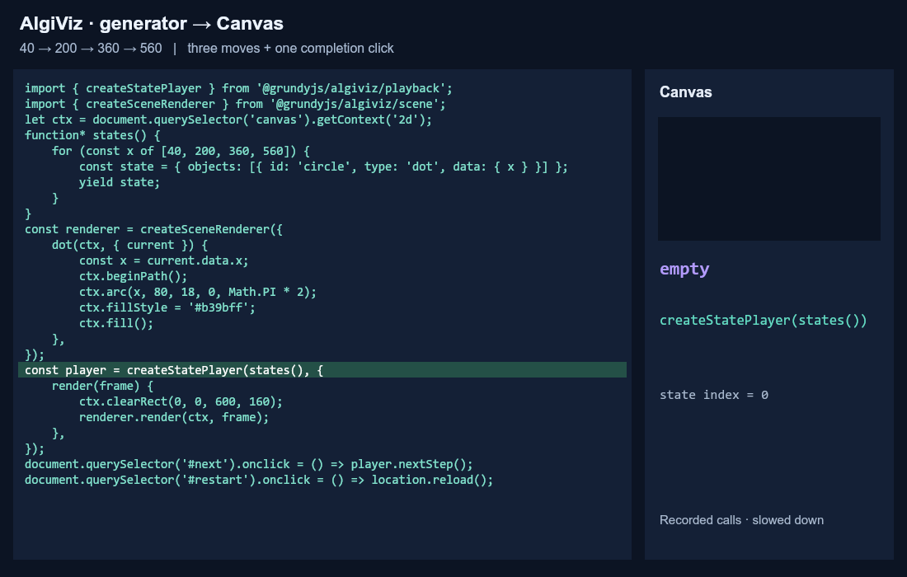

# Начало работы

[README](../../ru/README.md) · [English](../getting-started.md)

Начните с готовой панели, перейдите к ручному управлению, если интерфейс задаёт
приложение, затем подключите `/scene` для собственных типов объектов. Алгоритм,
состояния и отрисовка на каждом этапе остаются в приложении.

Установите `@grundyjs/algiviz` версии 0.12.0 или новее. Подключайте JavaScript как
модуль через сборщик, разрешающий публичные импорты установленного пакета.
Корневой точки входа нет. Примеры репозитория используют import map на локальную
сборку; см. [локальную настройку](../minimal-example.md#run-the-repository-example).

## Общие Canvas, состояния и отрисовка

```html
<div id="player">
  <canvas width="600" height="160"></canvas>
</div>
```

```js
const container = document.querySelector('#player');
const canvas = container.querySelector('canvas');
const ctx = canvas.getContext('2d');

function* states() {
  for (const x of [40, 200, 360, 560]) yield { x };
}

function draw({ current }) {
  ctx.clearRect(0, 0, canvas.width, canvas.height);
  ctx.beginPath();
  ctx.arc(current.x, 80, 18, 0, Math.PI * 2);
  ctx.fillStyle = '#b39bff';
  ctx.fill();
}
```

Каждый yield создаёт новый снимок. После выдачи его нельзя изменять. Отрисовка
использует только `current`, поэтому позиции меняются без плавного перехода.
Три подключения ниже используют эту основу и являются вариантами на выбор:
запускайте одно за раз, а перед заменой подключения вызывайте dispose у
предыдущего плеера.

## 1. Готовая панель через Player

```js
import { Player } from '@grundyjs/algiviz/player';

const player = new Player(container, {
  viewport: canvas,
  source: states,
  render: draw,
});
```

Конструктор создаёт панель, не вызывая `states`. Start показывает первый кадр
на паузе. Каждый Next state запрашивает следующий yield. Запрос после последнего
yield обнаруживает конец и сохраняет последний рисунок. Чтения вперёд нет.
Restart вызывает фабрику заново, поэтому `source` получает `states`, а не уже
созданный итератор `states()`.

Добавьте `stepDurationMs: 1000` в настройки для Play/Pause и выбора скорости.
Само время шага не делает рисунок плавным: для этого обработчик использует
`previous`, `current` и `progress`. При удалении вызовите `player.dispose()`:
панель, таймеры и слушатели удалятся, а Canvas и последний рисунок сохранятся.

Запустите [пример круга из README](../../examples/getting-started.html), затем
попробуйте [запись Canvas и поток SVG](../../examples/optional-player.html).
[Справочник плеера](player.md) описывает подписи, скрытие панели, историю, ошибки,
владение viewport и подключение `/player` через динамический `import()`.

## 2. Своя кнопка через createStatePlayer

Сохраните общую основу, добавьте свою кнопку после контейнера и замените
подключение `new Player(...)` выше следующим кодом:

```html
<button id="next">Следующее состояние</button>
```

```js
import { createStatePlayer } from '@grundyjs/algiviz/playback';

const player = createStatePlayer(states(), { render: draw });
document.querySelector('#next').onclick = () => player.nextStep();
```

Здесь первый кадр рисуется сразу при создании плеера. Каждый клик возобновляет
генератор и показывает одно следующее состояние. Дополнительный клик обнаруживает
завершение; `player.finished` становится true. Последний кадр остаётся доступен.

Приложение задаёт кнопки, перезапуск и при необходимости цикл анимации.
Для перезапуска удалите текущий экземпляр и создайте новый со свежим `states()`.
При удалении снимите собственные обработчики и вызовите `player.dispose()`.
Сам `/playback` не требует DOM; отрисовка и кнопка этого примера требуют.
См. [контракт воспроизведения](playback.md).

## 3. Собственные типы объектов через /scene

Для нескольких типов или устойчивых идентификаторов объектов между состояниями
представьте снимки как сцены и задайте обработчик каждого типа. Сохраните общие
Canvas, `states()` и ручную кнопку; замените предыдущее ручное подключение:

```js
import { createStatePlayer } from '@grundyjs/algiviz/playback';
import { createSceneRenderer } from '@grundyjs/algiviz/scene';

function* scenes() {
  for (const data of states()) {
    yield { objects: [{ id: 'circle', type: 'dot', data }] };
  }
}

const renderer = createSceneRenderer({
  dot(ctx, { current }) {
    ctx.beginPath();
    ctx.arc(current.data.x, 80, 18, 0, Math.PI * 2);
    ctx.fillStyle = '#b39bff';
    ctx.fill();
  },
});

const player = createStatePlayer(scenes(), {
  render(frame) {
    ctx.clearRect(0, 0, canvas.width, canvas.height);
    renderer.render(ctx, frame);
  },
});
document.querySelector('#next').onclick = () => player.nextStep();
```

`id` связывает объект между снимками; `type` выбирает обработчик; `data` содержит
ваши поля. AlgiViz сопоставляет объекты и вызывает обработчики, а приложение
определяет геометрию, цвета и плавность. Здесь круг есть в каждом снимке, поэтому
его текущий объект всегда присутствует. Для появления и удаления нужны проверки
nullable-концов перехода; см. [контракт сцены](scene.md).
Чтобы соединить сцены с готовой панелью, передайте `source: scenes` и тот же
render-обработчик в `new Player(...)` вместо ручного подключения.



*Этот GIF показывает ручное управление с `/scene`, а не готовую панель.
[Интерактивный разбор](../../examples/visualization-pipeline.html) замедляет реальные
вызовы и подсвечивает путь от клика через генератор к отрисовке. Его кнопка
«Начать» откладывает создание плеера, чтобы объяснить появление первого кадра.
Запускайте его по [инструкции локальной настройки](../minimal-example.md#run-the-repository-example).*

## Режимы воспроизведения и дальнейшие шаги

| | Генератор | Конечная запись |
| --- | --- | --- |
| Вход готового Player | `source: states` | `history: () => savedStates` с `stepDurationMs` |
| Чтение и хранение | По запросу; соседние снимки | Массив при Start; вся история |
| Перемотка назад | Нет | Да |
| Общая длительность | Неизвестна | Известна |
| Headless API | `createStatePlayer` / `createPlayer` | `createTimeline` |

Генератор сокращает хранимую историю, но не стоимость создания каждого снимка.
См. [память и производительность](performance.md). `createPlayer` — вариант
с явными шагами, когда нужны события и предикат завершения.

Продолжите с [самостоятельной интеграцией сцен](../minimal-example.md),
[полным примером TypeScript](../../examples/custom-objects.ts),
[разбором графа](../custom-graph-example.md) или [каталогом примеров](examples.md).
